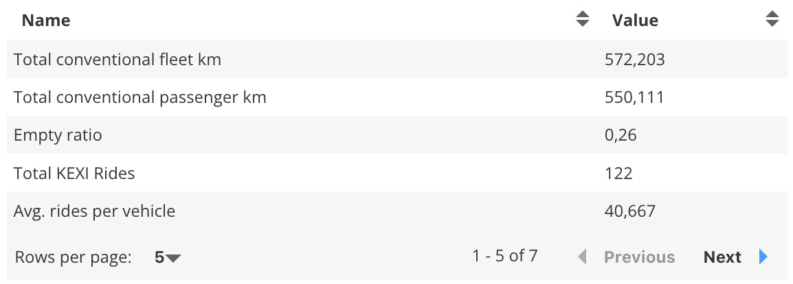
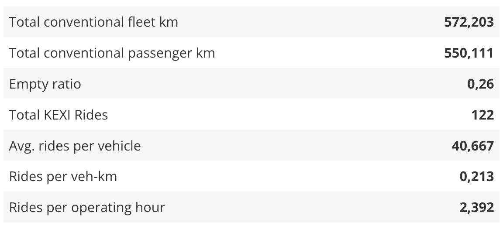

_CSV Table Viewer_

The CSV table viewer is able to display (small) csv files clearly.

## Usage

The table viewer can only be included as panels in **Dashboards**. See Dashboard documentation for general tips on creating dashboard configurations.

- Each table viewer panel is defined inside a **row** in a `dashboard-*.yaml` file.
- Use panel `type: csv` in the dashboard configuration.
- Standard title, description, and width fields define the frame.

### Highlighting specific cells

_New in v4.8:_ you can now highlight cells, columns and rows using CSS formatting, with the new `highlights:` section.

For each element you want to highlight, add a line to the `highlights` section


**Selecting cells, rows, columns for formatting**

You can use spreadsheet-style `A1` references where letter is column and number is row
- `B1: "color: red"`
 
Or use "row:1,col:2":
- `"row:1,col:2": "background: green"`

- An entire column can be selected with letter e.g. "A:A" or "B:B" for the entire first or second column:
  - `"B:B": "font-weight: bold"`
- Or an entire row, e.g. to highlight the third row:
  -  `"3:3": "color:red;background:white;font-weight:bold"`
  -  selects the third row 

**CSS Formatting cheat-sheet**

You can use any valid CSS to format a cell, but you will probably just want to change color and font. Set row and column formatting before individual cell formatting!

Typical options:

- `A2: "color:red"` or [any valid CSS color](https://external-content.duckduckgo.com/iu/?u=https%3A%2F%2Fi.pinimg.com%2F736x%2F1c%2F60%2F13%2F1c6013c9e39d0627e339ef7b60a26320.jpg&f=1&nofb=1&ipt=c141ee72ef66b3cec5feec6ec089c97cd358fab8d006b38dd17c0490a07bcf9a&ipo=images)
- `B:B: "background:green"` column B in green or [any valid CSS color](https://external-content.duckduckgo.com/iu/?u=https%3A%2F%2Fi.pinimg.com%2F736x%2F1c%2F60%2F13%2F1c6013c9e39d0627e339ef7b60a26320.jpg&f=1&nofb=1&ipt=c141ee72ef66b3cec5feec6ec089c97cd358fab8d006b38dd17c0490a07bcf9a&ipo=images)
- `"col:2": "font-weight:bold"` column 2 in bold 
- `3:3: "font-style:italic"` row 3 in italics
- `C1: "font-size:20px"` for changing text size

And you can **combine them with semicolons `;`**
- `E5: "color:green; background:white; font-weight:bold"`
- `A:A: "color:lightyellow; background:darkgrey"`

---

### Table styles

The Table plug-in provides various styles.

**Default Style:**

```yaml
style: default # Or just leave blank
```


_Default Style_

**Topsheet Style:**

```yaml
style: topsheet
```


_Topsheet Viewer_

---

### Table viewer properties

Table viewer properties:

**dataset:** String. The filepath containing the csv-file.

**enableFilter:** true/false. This option could be used to filter columns. This option adds a filter mask to each column. The default setting is false.

**hide:** Array of strings. List of column names that should be ignored.

**show:** Array of strings. List of column names that should be displayed. If the hide and show option are in the .yaml file the hide option will be ignored.

**showAllRows:** true/false. This option defines whether the whole table should be displayed or if there are several pages. The default setting is false.

**style:** String. This option specifies which style the table should have. The default value is default. Which styles are available can be looked up [here](#styles).

**hideHeader:** true/false. This option defines whether the header is visible or not. The default is false. Note: Even if no header is to be displayed, the table needs a header row.

**highlights:** list of key/value pairs identifying cells and CSS formatting (see above)


---

### Sample dashboard.yaml config snippet

```yaml
layout:
  row1:
    - type: 'csv'
      title: Example Title
      dataset: 'data.csv'
      enableFilter: true
      hide: [bike, car]
      show: [bus]
      showAllrows: false
      hideHeader: false
      style: default
      highlights:
        A:A: "background:yellow" # entire first column
        3:3: "font-weight: bold" # entire third row
        B1: "color:red"
        C2: "color:green"
        A3: "color:yellow; background:blue; font-weight:bold"
```
