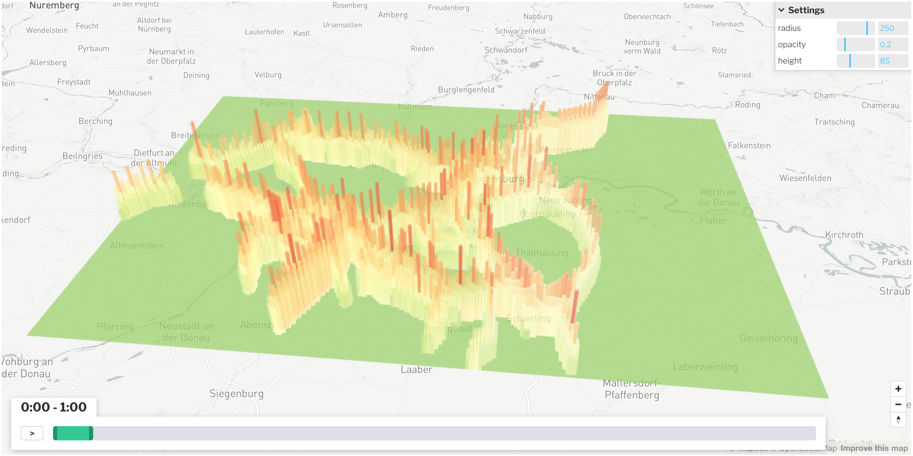

_Gridmap plot over a period of time_

Gridmap Plots are excellent for plotting emissions or other data at a specific point in time or over a period of time.

## Creating this panel

Gridmap plots can be read in a dashboard file they go in the `layout:` section of a `dashboard-*.yaml` file. See the examples at the end of this document.


**Embed in Dashboard:** Create a `dashboard-*.yaml` file and include a `type: gridmap` section as described below.

- Each area map panel is defined inside a **row** in a `dashboard-*.yaml` file.
- Use panel `type: gridmap` in the dashboard configuration.
- Standard title, description, and width fields define the frame.
- See [Dashboard documentation](dashboards) for general tips on creating dashboard configurations.


## Embed in Dashboard

In addition to the standard dashboard configurations, the following properties are available:

- **file:** *String*. The file path to the data: an `.avro` file ([Avro Schema](#avro-schema)) or a CSV file ([CSV Files](#csv-files)).

- **projection:** *String*. Coordinate system of the x/y coordinates, e.g. `EPSG:25832`. Required unless the Avro file has a `crs` field or the CSV file has a comment line containing `EPSG:xxxx`.

- **valueColumn:** *String*. CSV only. The column whose values color the cells. If it is missing or not found, the first numeric column is used. The column can be changed in the UI. With `dataColumns`, this names the buttons that start out on instead; see [Data Column Buttons](#data-column-buttons).

- **diff:** *Boolean*. CSV only. If true, cells show `valueColumn` minus `secondValueColumn`. Can be switched in the UI.

- **secondValueColumn:** *String*. CSV only. The column subtracted from `valueColumn` when `diff` is on.

- **dataColumns:** *Array*. CSV only. Replaces the column dropdowns with toggle buttons; each cell shows the maximum of the columns that are switched on. See [Data Column Buttons](#data-column-buttons).

- **unit:** *String*. Unit shown in the tooltip and on the summary chart, e.g. `Utils`.

- **cellSize:** *Number*. Specifies the width/height of the grid elements (must be between 50 and 300). This value can be adjusted in the UI via the settings.

- **opacity:** *Float*. Defines the opacity of the grid map. The value must be between 0 and 1 and can also be changed in the UI via the settings.

- **maxHeight:** *Number*. Starting value of the 3D height slider; 0 means a flat map. Must be a positive integer. Cells are always drawn flat if any value on the map is negative.

- **colorRamp/ramp:** *String*. Specifies the colorramp. Possible colorramps are: *Inferno*, *Magma*, *Viridis*, *Greens*, *Reds*, *RdYlGn*, *greenRed*, *RdBu*. The default value is *Viridis*.

- **thresholdGrayOut:** *String*, `less` or `greater`. Which cells the Threshold slider in the settings panel grays out: those *less* than (at or below) the slider value, or those *greater* than (at or above) it. The slider always starts at the end that leaves the map fully colored. Can also be changed in the UI. The default value is *less*.

- **populationColumn:** *String*. CSV only. The summary chart above the settings panel shows the cumulative share of population at or below each value, weighting each cell by this column. The default value is *population*; if that column does not exist, every cell counts equally.

The `.yaml` file could then look like this (Here are both variants of how to define breakpoints. However, only one of the two variants may be used at most):

```yaml
- type: gridmap
  title: Noise Immissions
  description: Noise Immissions per day
  height: 12.0
  file: analysis/noise/immission_per_day.avro
  cellSize: 250
  opacity: 0.2
  maxHeight: 20
  colorRamp:
    reverse: false
    ramp: greenRed
    steps: 10
```

### Data Column Buttons

With a `dataColumns` section, the settings panel shows a row of toggle buttons in place of the column dropdowns. Each entry needs a **label** (the button text) and a **column** (a CSV column name). Several buttons can be on at once: each cell then shows the **maximum** of those columns, so for accessibility data the map shows the best of the selected modes. If no button is on, the map is blank.

With **Diff** checked, a second row of buttons, **Compare to**, appears. Cells then show the maximum of the *Data columns* minus the maximum of the *Compare to* columns. If no *Compare to* button is on, the *Data columns* are shown alone.

`valueColumn` and `secondValueColumn` choose which buttons start out on: one label or a list of labels (column names work too). Without `valueColumn`, the first button starts out on.

The tooltip lists the value of every selected column for that cell, and the summary chart and threshold slider are titled after the selection, e.g. `max(DRT, PT) − max(Walk)`.

Entries without a label or column, columns that are not in the file, and repeated labels are skipped with a warning. If no entries are usable, the column dropdowns are shown instead. `dataColumns` only works with CSV files.

```yaml
- type: gridmap
  title: Accessibility to supermarkets
  file: analysis/accessibility/supermarket/accessibilities_simwrapper.csv
  projection: EPSG:25832
  cellSize: 500
  unit: Utils
  valueColumn: [DRT, PT]
  secondValueColumn: Walk
  diff: true
  dataColumns:
    - label: Car
      column: car_accessibility
    - label: DRT
      column: estimatedDrt_accessibility
    - label: PT
      column: pt_accessibility
    - label: Walk
      column: teleportedWalk_accessibility
```

### CSV Files

A CSV file has one row per grid cell per time period. It must have the columns `x`, `y` (cell center coordinates, in the coordinate system given by `projection`) and `time` (in seconds). Every other column can be shown on the map with `valueColumn`, `dataColumns`, or the column dropdowns in the UI.

```csv
x,y,time,teleportedWalk_accessibility,pt_accessibility,population
711701.8,5384862.3,0,-17.02,-17.02,2
711701.8,5384862.3,66600,-17.02,-17.02,2
```

### Avro Schema

The Avro schema defines the structure of the data stored in the Avro format. It consists of a record with several fields containing different types of information. Below is an explanation of the key fields:

- **crs** (*string*): This field stores the Coordinate Reference System (CRS) used for the spatial data.
  
- **xCoords** (*array of floats*): A list of X coordinates representing the horizontal positions in a Cartesian coordinate system.
  
- **yCoords** (*array of floats*): A list of Y coordinates representing the vertical positions in a Cartesian coordinate system.
  
- **timestamps** (*array of integers*): A list of timestamps in seconds. Each timestamp corresponds to an X-Y coordinate pair and represents the time at which the position was recorded.
  
- **data** (*map of arrays of floats*): A mapping of keys to arrays of floating-point numbers. This field contains the XYT data, which are coordinates and associated values tied to the timestamps.

This structure is optimized for storing spatio-temporal data, useful for applications such as geospatial data processing or simulations that handle such information.

```json
{
  "type" : "record",
  "name" : "XYTData",
  "namespace" : "org.matsim.application.avro",
  "fields" : [ 
    {
      "name" : "crs",
      "type" : "string",
      "doc" : "Coordinate reference system"
    }, 
    {
      "name" : "xCoords",
      "type" : {
        "type" : "array",
        "items" : "float"
      },
      "doc" : "List of x coordinates"
    }, 
    {
      "name" : "yCoords",
      "type" : {
        "type" : "array",
        "items" : "float"
      },
      "doc" : "List of y coordinates"
    }, 
    {
      "name" : "timestamps",
      "type" : {
        "type" : "array",
        "items" : "int"
      },
      "doc" : "List of timestamps in seconds"
    }, 
    {
      "name" : "data",
      "type" : {
        "type" : "map",
        "values" : {
          "type" : "array",
          "items" : "float"
        }
      },
      "doc" : "XYT data"
    } 
  ]
}
```