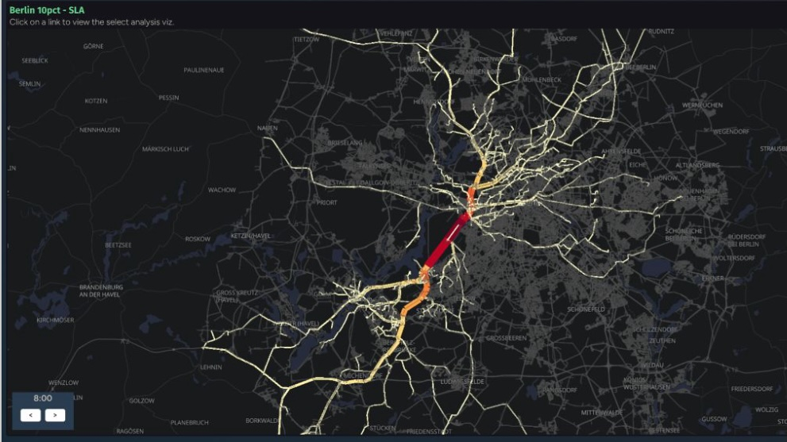

Announcing the release of SimWrapper 4.8, available now on **https://simwrapper.app**, and on [GitHub](https://github.com/simwrapper/simwrapper).

### Comments and formatting in CSV Files

We skipped a release (4.7) that only had one new feature: the ability to add comments to CSV files. Now the content of any line that begins with `#` will be added to a special "Info" section of a chart which references that CSV.  This is intended to allow analysts to insert notes into a chart separately from the YAML configuration for a panel.

Note that panels have for a long time been able to include text, using the `title` `description` and `caption` entries.

CSV tables can also now have formatting applied to specific rows, columns, or indivual cells: so if you want to make one cell bold or with red text etc., now you can.  Details are here:

- https://docs.simwrapper.app/docs/csv#highlighting-specific-cells

### Retiring technical debt: Vue 3.x and Deck.gl 9.2

SimWrapper's roots go way back to 2021, which is hard to imagine now! But some of the core libraries used for building it have moved ahead since then, causing breaking changes that we wanted to avoid. It was finally time to "retire the tech debt" and upgrade Vue, Vite, Deck.gl, and many other support libraries that form the basis of the project.

If you don't know what those are, it shouldn't matter: all existing dashboards should still work. And if they don't, please file a bug!

Also in the plumbing upgrade is a big investment in automated user interface testing (using Playwright). This helped ensure that existing visualizations and dashboards didn't break during the migration. Of course things may have slipped through: [https://github.com/simwrapper/simwrapper/issues](file a bug report) on GitHub and we'll solve any new problems.

### MATSim Select-link (beta)

_Work-in-progress select link plot for MATSim_

Our bachelor degree student assistant has been hard at work on developing a select-link visualizer for MATSim scenarios. If you want to learn more, please contact us! The first version will be available soon, and testing on real external outputs would be really helpful!

### More to come!

Please start a chat or follow along on the [SimWrapper discussion board](https://github.com/orgs/simwrapper/discussions) if you have suggestions, comments, cheers & jeers!

We are working on lots of other new features and continue to sharpen SimWrapper based on your feedback! Thanks for your support 🙏
